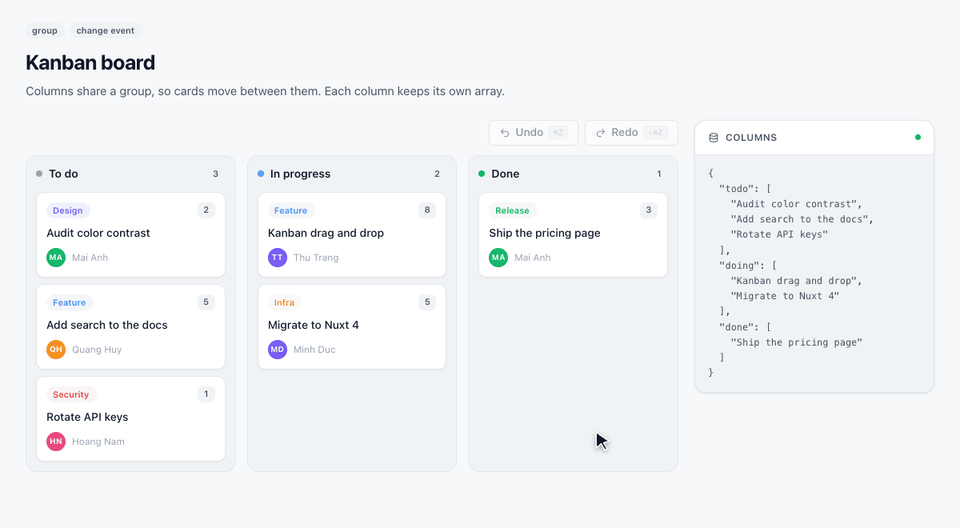
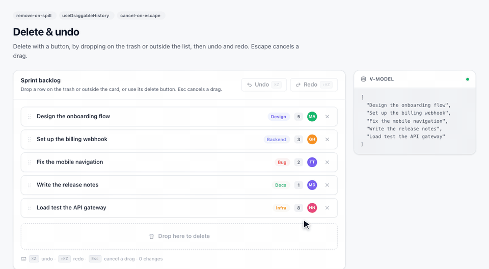
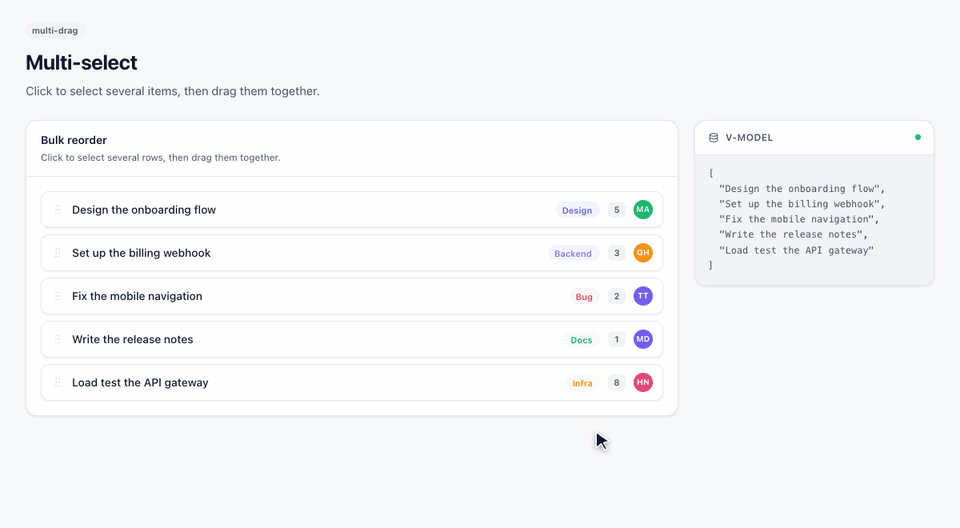

# @stacklogs/vue-draggable

**Vue 3 drag and drop component for sortable lists.** Reorder items, drag between lists, clone
items into another list, build nested trees and kanban boards, animate with `transition-group`,
select several items at once or swap two items — delete by dropping outside, undo and redo,
cancel with Escape — with full TypeScript support and server-side rendering.



```bash
npm install @stacklogs/vue-draggable
```

## Features

- **Sortable lists in one component** — bind an array with `v-model` and render each item with a slot.
- **Drag between lists** — share a `group` to move items across lists, or clone them.
- **Nested drag and drop** — recursive components for trees, outlines and kanban boards.
- **Animations** — works with `tag="transition-group"` for smooth reordering.
- **Multi-select drag and swap** — drag several selected items together, or swap two items.
- **Delete, undo and redo** — drop on a trash zone or outside the list, then undo with ⌘Z / Ctrl+Z.
- **Cancel with Escape** — press Esc during a drag and nothing changes.
- **Handles, filters, disabled items** — fine-grained control over what can be dragged.
- **TypeScript** — the item slot is typed from your list; events and refs are typed.
- **SSR and Nuxt** — renders on the server, hydrates without mismatch; a Nuxt module is available.
- **Small and modern** — 5.6 KB min+gzip for the component, ES module and CommonJS builds, ES2019.
- **Vue 3.0 to 3.5** — tested on Vue 3.2, 3.3, 3.4 and 3.5.

## Installation

```bash
npm install @stacklogs/vue-draggable
# or
pnpm add @stacklogs/vue-draggable
# or
yarn add @stacklogs/vue-draggable
# or
bun add @stacklogs/vue-draggable
```

Vue 3 is the only peer dependency. The drag-and-drop engine is installed with the package.

## Quick start

```vue
<script setup lang="ts">
import { ref } from 'vue';
import draggable from '@stacklogs/vue-draggable';

const tasks = ref([
  { id: 1, title: 'Design the board' },
  { id: 2, title: 'Write the API' },
  { id: 3, title: 'Ship it' },
]);
</script>

<template>
  <draggable v-model="tasks" item-key="id" :animation="150" ghost-class="ghost">
    <template #item="{ element, index }">
      <div class="task">{{ index + 1 }}. {{ element.title }}</div>
    </template>
  </draggable>
</template>
```

Register it globally if you prefer:

```ts
import { createApp } from 'vue';
import draggable from '@stacklogs/vue-draggable';
import App from './App.vue';

createApp(App).component('draggable', draggable).mount('#app');
```

## Examples

### Drag and drop between two lists

```vue
<draggable v-model="todo" group="tasks" item-key="id">
  <template #item="{ element }"><li>{{ element.title }}</li></template>
</draggable>
<draggable v-model="done" group="tasks" item-key="id">
  <template #item="{ element }"><li>{{ element.title }}</li></template>
</draggable>
```

### Clone items from a palette

```vue
<script setup lang="ts">
let nextId = 100;
const cloneWidget = (widget: { type: string }) => ({ id: nextId++, type: widget.type });
</script>

<template>
  <draggable
    :list="palette"
    :group="{ name: 'widgets', pull: 'clone', put: false }"
    :clone="cloneWidget"
    :sort="false"
    item-key="type"
  >
    <template #item="{ element }"
      ><div>{{ element.type }}</div></template
    >
  </draggable>
  <draggable v-model="page" group="widgets" item-key="id">
    <template #item="{ element }"
      ><section>{{ element.type }}</section></template
    >
  </draggable>
</template>
```

### Drag handle

```vue
<draggable v-model="rows" item-key="id" handle=".handle" tag="ul">
  <template #item="{ element }">
    <li><span class="handle">⠿</span> {{ element.name }}</li>
  </template>
</draggable>
```

### Animated reordering with transition-group

```vue
<draggable
  v-model="list"
  item-key="id"
  tag="transition-group"
  :component-data="{ tag: 'ul', name: 'flip-list' }"
>
  <template #item="{ element }"><li>{{ element.name }}</li></template>
</draggable>

<style>
.flip-list-move {
  transition: transform 0.4s;
}
</style>
```

### Header and footer

```vue
<draggable v-model="items" item-key="id" tag="ul">
  <template #header><li class="title">Backlog</li></template>
  <template #item="{ element }"><li>{{ element.title }}</li></template>
  <template #footer><li><button @click="add">Add card</button></li></template>
</draggable>
```

### Nested drag and drop (tree)

```vue
<!-- TaskTree.vue -->
<script setup lang="ts">
interface Task {
  name: string;
  tasks: Task[];
}
defineProps<{ tasks: Task[] }>();
</script>

<template>
  <draggable :list="tasks" item-key="name" group="tree" tag="ul">
    <template #item="{ element }">
      <li>
        {{ element.name }}
        <TaskTree :tasks="element.tasks" />
      </li>
    </template>
  </draggable>
</template>
```

### Prevent some moves

```vue
<script setup lang="ts">
import type { DraggableMoveEvent } from '@stacklogs/vue-draggable';

// Locked items cannot be dragged past or dropped onto.
const canMove = (evt: DraggableMoveEvent) => !evt.relatedContext.element?.locked;
</script>

<template>
  <draggable v-model="items" item-key="id" :move="canMove">…</draggable>
</template>
```

## API

### Props

| Prop            | Type                                      | Default  | Description                                                                                                                                                                         |
| --------------- | ----------------------------------------- | -------- | ----------------------------------------------------------------------------------------------------------------------------------------------------------------------------------- |
| `modelValue`    | `Array`                                   | `null`   | The list, with `v-model`. A new array is emitted on every change.                                                                                                                   |
| `list`          | `Array`                                   | `null`   | Alternative to `v-model`: the array is updated in place. Use one or the other.                                                                                                      |
| `itemKey`       | `string \| (element) => key`              | required | Property name or function that gives each item a unique key.                                                                                                                        |
| `tag`           | `string`                                  | `'div'`  | Root element: an HTML tag, `'transition-group'`, or a globally registered component.                                                                                                |
| `componentData` | `Object`                                  | `null`   | Props, attributes and listeners for the root element or component.                                                                                                                  |
| `clone`         | `(original) => copy`                      | identity | Creates the copy when items are cloned into another list.                                                                                                                           |
| `move`          | `(evt, originalEvent) => boolean \| void` | `null`   | Called while dragging; return `false` to cancel the move. `evt.draggedContext` is `{ element, index, futureIndex }`, `evt.relatedContext` is `{ list, component, element, index }`. |

### Drag options

Pass them as attributes, in kebab-case or camelCase. Changing one at runtime takes effect
immediately.

| Option                          | Example                                           | Description                                                                         |
| ------------------------------- | ------------------------------------------------- | ----------------------------------------------------------------------------------- |
| `group`                         | `group="tasks"` or `:group="{ name, pull, put }"` | Lists with the same group exchange items; `pull: 'clone'` copies instead of moving. |
| `sort`                          | `:sort="false"`                                   | Allow reordering inside the list.                                                   |
| `disabled`                      | `:disabled="locked"`                              | Turn dragging off.                                                                  |
| `handle`                        | `handle=".handle"`                                | Only this part of an item starts a drag.                                            |
| `filter`                        | `filter=".pinned"`                                | Items that cannot be dragged.                                                       |
| `draggable`                     | `draggable=".card"`                               | Which children can be dragged.                                                      |
| `animation`                     | `:animation="150"`                                | Duration of the reorder animation, in ms.                                           |
| `ghost-class`                   | `ghost-class="ghost"`                             | Class of the drop placeholder.                                                      |
| `chosen-class` / `drag-class`   | `drag-class="dragging"`                           | Classes of the chosen and dragged item.                                             |
| `delay` / `delay-on-touch-only` | `:delay="150"`                                    | Hold before dragging starts (useful on touch screens).                              |
| `force-fallback`                | `:force-fallback="true"`                          | Pointer-based dragging instead of native drag and drop.                             |
| `empty-insert-threshold`        | `:empty-insert-threshold="20"`                    | Drop distance for empty lists.                                                      |
| `direction`                     | `direction="horizontal"`                          | Layout direction of the list.                                                       |
| `scroll`                        | `:scroll="true"`                                  | Auto-scroll while dragging near an edge.                                            |
| `remove-on-spill`               | `:remove-on-spill="true"`                         | Dropping outside every list deletes the item.                                       |
| `revert-on-spill`               | `:revert-on-spill="true"`                         | Dropping outside every list sends the item back.                                    |
| `cancel-on-escape`              | `:cancel-on-escape="true"`                        | Escape during a drag cancels it.                                                    |

`id`, `class`, `role`, `style`, `data-*` and `aria-*` attributes and event listeners go to the
root element.

### Slots

| Slot     | Props                | Description                                             |
| -------- | -------------------- | ------------------------------------------------------- |
| `item`   | `{ element, index }` | Renders one item. Must render exactly one root element. |
| `header` | —                    | Content before the items (not draggable).               |
| `footer` | —                    | Content after the items (not draggable).                |

### Events

| Event                       | Payload                                   | When                                                                                                                      |
| --------------------------- | ----------------------------------------- | ------------------------------------------------------------------------------------------------------------------------- |
| `update:modelValue`         | the new array                             | The list changed (used by `v-model`).                                                                                     |
| `change`                    | `{ added }`, `{ removed }` or `{ moved }` | After a drop: `added: { element, newIndex }`, `removed: { element, oldIndex }`, `moved: { element, oldIndex, newIndex }`. |
| `start` / `end`             | drag event                                | Dragging started / ended.                                                                                                 |
| `add` / `remove` / `update` | drag event                                | An item arrived, left, or moved inside this list.                                                                         |
| `choose` / `unchoose`       | drag event                                | An item was picked / released.                                                                                            |
| `sort`                      | drag event                                | The order changed.                                                                                                        |
| `filter`                    | drag event                                | A filtered item was clicked.                                                                                              |
| `clone`                     | drag event                                | An item was cloned.                                                                                                       |
| `spill`                     | drag event                                | The item was dropped outside every list (`remove-on-spill` / `revert-on-spill`).                                          |

### Delete, undo and redo



```vue
<script setup lang="ts">
import { ref } from 'vue';
import { useDraggableHistory } from '@stacklogs/vue-draggable/history';

const tasks = ref(loadTasks());
const trash = ref([]);
// Ctrl/⌘+Z to undo, Ctrl/⌘+Shift+Z or Ctrl+Y to redo.
const history = useDraggableHistory(tasks, { keyboard: true });
const remove = (task) => (tasks.value = tasks.value.filter((t) => t !== task));
</script>

<template>
  <button :disabled="!history.canUndo.value" @click="history.undo()">Undo</button>
  <button :disabled="!history.canRedo.value" @click="history.redo()">Redo</button>

  <draggable
    v-model="tasks"
    item-key="id"
    group="tasks"
    :remove-on-spill="true"
    :cancel-on-escape="true"
    filter=".delete"
    :prevent-on-filter="false"
  >
    <template #item="{ element }">
      <li>{{ element.title }} <button class="delete" @click="remove(element)">✕</button></li>
    </template>
  </draggable>

  <!-- A trash zone: items dropped here leave the list. -->
  <draggable
    v-model="trash"
    item-key="id"
    :group="{ name: 'tasks', pull: false, put: true }"
    @add="trash = []"
  >
    <template #item="{ element }"
      ><span hidden>{{ element.title }}</span></template
    >
  </draggable>
</template>
```

- **Delete with a button**: remove the item from your array; the list follows.
- **Drop on a trash zone**: a list that accepts items and empties itself on `add`.
- **Drop outside every list**: `:remove-on-spill="true"` deletes the item from the DOM and from the
  data (`change` with `removed`, then `spill`). `:revert-on-spill="true"` sends it back instead.
- **Undo and redo**: `useDraggableHistory(ref)` records one step per drop and restores order and
  membership. Pass an array of refs to cover several lists: a move between two lists is one step.
  It returns `undo`, `redo`, `canUndo`, `canRedo`, `size` and `clear`.
- **Cancel with Escape**: with `:cancel-on-escape="true"`, Escape during a drag puts the item back and
  leaves the data untouched (no `change` event).

### Template ref

```ts
const list = ref<InstanceType<typeof draggable>>();
list.value?._sortable; // the drag-and-drop instance of this list
```

## Multi-select drag and swap



Mount the plugins once, then enable them per list:

```ts
// main.ts
import { mountSortablePlugins } from '@stacklogs/vue-draggable/plugins';

mountSortablePlugins('MultiDrag', 'Swap');
```

```vue
<!-- click items to select them, then drag them together -->
<draggable v-model="files" item-key="id" :multi-drag="true" selected-class="selected">…</draggable>

<!-- drop an item onto another to swap them -->
<draggable v-model="slots" item-key="id" :swap="true" swap-class="highlight">…</draggable>
```

The list stays in sync: a multi-select drop emits one `change` per moved item, a swap emits two
`moved` changes.

Bind boolean options with a value (`:multi-drag="true"`, `:swap="true"`, `:disabled="true"`): a bare
attribute such as `multi-drag` reaches the component as an empty string, which turns the option off.

## Default options for every list

```ts
import { draggableDefaultsKey } from '@stacklogs/vue-draggable/plugins';

app.provide(draggableDefaultsKey, { animation: 150, ghostClass: 'ghost' });
```

A list's own attributes always take precedence.

## TypeScript

Types are included. The item slot is typed from the list you pass:

```vue
<script setup lang="ts">
interface Task {
  id: number;
  title: string;
}
const tasks = ref<Task[]>([]);
</script>

<template>
  <draggable v-model="tasks" item-key="id">
    <!-- element: Task -->
    <template #item="{ element }">{{ element.title }}</template>
  </draggable>
</template>
```

Exported types: `DraggableChangeEvent`, `DraggableMoveEvent`, `DraggableContext`,
`DraggableProps`, `DraggableSlots`, `DraggableInstance`.

## Server-side rendering and Nuxt

The component can be imported on the server: it never touches `window` or `document` there.
Lists render on the server exactly as on the first client render, so hydration has no mismatch,
and dragging starts once the component is mounted in the browser.

For Nuxt 3 and Nuxt 4, use [`@stacklogs/nuxt-draggable`](https://www.npmjs.com/package/@stacklogs/nuxt-draggable):
auto-imported `<Draggable>`, plugins and default options from `nuxt.config`, and no drag-and-drop
code in the server bundle.

## Entry points

| Import                             | Contents                                                  |
| ---------------------------------- | --------------------------------------------------------- |
| `@stacklogs/vue-draggable`         | The `draggable` component (default export) and its types. |
| `@stacklogs/vue-draggable/plugins` | `mountSortablePlugins`, `draggableDefaultsKey`.           |
| `@stacklogs/vue-draggable/history` | `useDraggableHistory` (undo / redo).                      |

## Compatibility

- Vue `^3.0.1`, tested on 3.2, 3.3, 3.4 and 3.5.
- ES module, CommonJS and UMD builds, all ES2019; types for `import` and `require`.
- Tested with Vite, webpack 5, Rollup and esbuild.
- Works in Web Workers and edge runtimes for server-side rendering.

## License

MIT. Includes MIT-licensed code; see `THIRD_PARTY_NOTICES.md`.
